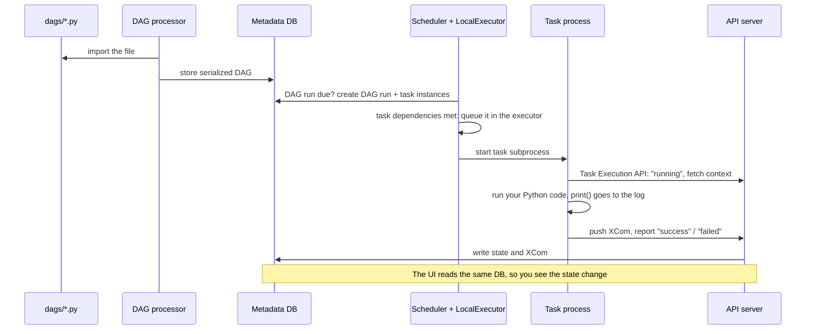

# Lesson 00: Docker Compose setup and architecture

## Goal

Run Airflow 3.4 locally in Docker Compose, understand which processes make up Airflow and what
each does, and run your first DAG three different ways.

## Concepts

### The pieces of Airflow

Airflow is not one program. It is a few cooperating processes that share a **metadata database**.
In this stack each one is its own container:

| Container | Command | What it does |
|---|---|---|
| `postgres` | – | **Metadata database.** The single source of truth: serialized DAGs, DAG runs, task instances and their states, XComs, connections, variables, users. |
| `airflow-dag-processor` | `airflow dag-processor` | **Parses your DAG files.** Repeatedly imports every `.py` file in `dags/`, and stores each DAG it finds, serialized, in the database. Import errors are recorded here too. |
| `airflow-scheduler` | `airflow scheduler` | **Decides what runs when.** Creates DAG runs when their schedule is due, works out which task instances are ready (dependencies met), and hands them to the **executor**. |
| (executor) | inside the scheduler | **Decides how tasks run.** We use the `LocalExecutor`: each task runs as a subprocess of the scheduler container. Other executors send tasks to Celery workers or Kubernetes pods. |
| `airflow-apiserver` | `airflow api-server` | **The UI and APIs.** Serves the web UI and the public REST API (`/api/v2`), and the **Task Execution API** (`/execution`), through which running tasks report their state. |
| `airflow-triggerer` | `airflow triggerer` | **Waits efficiently.** Runs the async triggers of *deferred* tasks (deferrable sensors and operators, lesson 07), so a task waiting for an hour does not hold a worker slot. |
| `airflow-init` | one-off | Migrates the database schema, creates the admin user, fixes folder ownership, then exits. |

The folders `dags/`, `logs/`, `plugins/` and `config/` on your machine are mounted into every
Airflow container at `/opt/airflow/...`. Edit a DAG locally and the DAG processor picks it up.

### How one task run flows through them



Two Airflow 3 details worth remembering:

- **Task code never talks to the database directly.** It goes through the API server's Task
  Execution API. That is why tasks import from `airflow.sdk`, the Task SDK.
- **The scheduler never imports your DAG files.** It works from the serialized copies the DAG
  processor stored. A DAG with an import error simply does not exist for the scheduler.

## Run it

All commands run from the repository root (the folder with `docker-compose.yaml`).

### 1. Configure (once)

```bash
cp .env.example .env
```

Edit `.env` and set `AIRFLOW_UID` to the output of `id -u` (usually `1000`), so files the
containers create in `logs/` belong to you. `.env` is git-ignored. All its variables have
defaults, so it is optional; without it you can also run `export AIRFLOW_UID=$(id -u)` first.

### 2. Start, stop, reset

```bash
docker compose up -d          # start everything in the background (first start pulls ~1GB)
docker compose ps             # all services should become "(healthy)" within a minute
docker compose logs -f airflow-scheduler   # follow one service's logs (Ctrl+C to stop)
docker compose stop           # stop the containers, keep everything
docker compose down           # remove the containers, keep the database volume
docker compose down -v        # remove containers AND the database: a clean slate
```

The project name is fixed to `airflow-learning` in `docker-compose.yaml`, so there is only ever
one stack. It mounts `dags/` from the folder you ran `docker compose up` in: when you switch to
another checkout of this repository, run `docker compose up -d` there again.

### 3. Open the UI

Go to <http://localhost:8080> and log in with `airflow` / `airflow` (or what you set in `.env`).

You should see one DAG: `l00_hello_airflow`. New DAGs start **paused**
(`DAGS_ARE_PAUSED_AT_CREATION`), so nothing runs until you say so.

### 4. Run your first DAG

`dags/l00_setup/hello_airflow.py` has two tasks: `say_hello` returns a name, and `greet`
receives it. Run it three ways:

**a) From the UI.** Unpause the DAG with its toggle, then press **Trigger**. Open the run in the
**Grid** view, click a task, and open **Logs**: find the `Hello ...` lines.

**b) From the CLI, through the scheduler.** Airflow's CLI is available inside any Airflow
container:

```bash
docker compose exec airflow-scheduler airflow dags unpause l00_hello_airflow
docker compose exec airflow-scheduler airflow dags trigger l00_hello_airflow
docker compose exec airflow-scheduler airflow dags list-runs l00_hello_airflow
```

The run shows `queued`, then `success` after a few seconds. The task logs also land on your
machine: look in `logs/dag_id=l00_hello_airflow/`.

**c) With `airflow dags test`, without the scheduler.** It runs the whole DAG once, in the
current process, and prints the task logs straight to your terminal. This is the fastest way to
try out a DAG while you write it:

```bash
docker compose exec airflow-scheduler airflow dags test l00_hello_airflow
```

### 5. Other useful commands

```bash
docker compose exec airflow-scheduler airflow version
docker compose exec airflow-scheduler airflow dags list
docker compose exec airflow-scheduler airflow dags list-import-errors   # "No data found" is good
docker compose exec airflow-scheduler bash                              # a shell inside Airflow
docker compose run --rm airflow-cli airflow config get-value core executor  # one-off container
curl -s localhost:8080/api/v2/monitor/health                            # health of every component
```

## Try this

1. **Break a DAG.** Add a typo to `hello_airflow.py` (e.g. `import platfrom`). Within about 30
   seconds the UI shows an import error banner, and `airflow dags list-import-errors` names the
   file. Which container reported it? (`docker compose logs airflow-dag-processor`.) Fix it.
2. **Change the output.** Change the `greet` message, trigger again, and compare the logs of the
   two runs in the Grid view. Each run keeps its own logs.
3. **Stop the scheduler.** `docker compose stop airflow-scheduler`, then trigger the DAG in the
   UI. The run stays `queued` forever. Why? Start it again with `docker compose start
   airflow-scheduler` and watch the run finish.
4. **Find the XCom.** In the UI, open the `say_hello` task instance and find the **XCom** tab.
   The returned `"Airflow"` is stored in the metadata database and passed to `greet`.
5. **Clean slate.** `docker compose down -v && docker compose up -d`. Your DAG file is still
   there, but the run history is gone. What lives in the database and what lives in files?

## Recap

- Airflow = DAG processor + scheduler (with an executor) + API server + triggerer, sharing one
  metadata database.
- DAG files are parsed by the DAG processor; the scheduler only sees their serialized form.
- Tasks run through the executor and report back through the API server's Task Execution API.
- `docker compose up -d` / `down` / `down -v` manage the stack; `docker compose exec
  airflow-scheduler airflow ...` runs any CLI command; `airflow dags test` runs a DAG directly.
